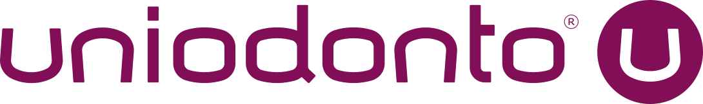
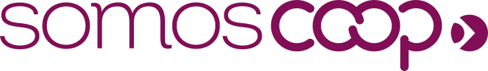

# AGENTS.md — Uniodonto Design System

Contexto operacional para agentes de código e de conteúdo (Codex, ChatGPT, Claude, Gemini, Cursor etc.) que produzem peças, telas ou textos da marca **Uniodonto**, a primeira cooperativa odontológica do Brasil.

> Fonte de verdade: este repositório. Os valores daqui vencem qualquer coisa que você "saiba" sobre a marca. Se algo não estiver aqui, pergunte — não invente cor, fonte, ícone ou logo.

## Ordem de leitura

1. `RULES.md` — regras resumidas (cor, tipo, tom, componentes). **Leia sempre.**
2. `tokens.json` (dados) ou `tokens.css` (variáveis CSS prontas). Tabela legível: `docs/tokens.md`.
3. `brandbook/` — brand book completo em Markdown, na ordem 01→06.
4. `assets/<Grupo>/README.md` — antes de usar qualquer arquivo de um grupo.
5. `components/<Comp>/README.md` + `preview.html` — regras e exemplo de cada componente.

Sem acesso ao repositório inteiro? Use `llms.txt` (índice com URLs) ou `llms-full.txt` (todo o texto em um arquivo).

## Regras inegociáveis

- **SomosCoop em toda peça.** O selo (`assets/SomosCoop/`) assina todas as expressões da marca: num canto oposto à marca Uniodonto, no máximo 3/4 da largura do logotipo, em branco ou numa cor da paleta. Nunca redesenhe o selo.
- **Vinho-Escuro `#810e56` (`--uni-vinho-escuro`) identifica a instituição** e está sempre presente. A paleta vibrante (roxo, pêssego, ciano, lima, goiaba) é apoio — nunca substitui o vinho e nunca é cor de texto corrido.
- **Fundo claro só branco `#ffffff` ou `#f3f7fa`.** Nunca rosado ou avinhado.
- **Fonte: Georama** (`fonts/`, OFL). Títulos em regular; destaque em itálico no peso oposto. Texto corrido com entreletra 0.035em e entrelinha 130%. Arial só onde Georama não carrega (e-mail, editores). Caveat só em peça não institucional.
- **Logos, símbolo, submarcas e ícones: só os SVGs oficiais de `assets/`.** Nunca desenhe, recolora, distorça, rotacione ou aplique efeito. Área de proteção = altura do "U".
- **Peças da operadora levam a tarja ANS** (`components/TarjaANS`), com dados atualizados.
- **Tom:** confiável, cuidadoso, acolhedor, simples, alegre. "Nós" para o espírito cooperativista; "a Uniodonto" para afirmar experiência. Caixa alta e baixa ("Contratar Plano"); nunca títulos todos em maiúsculas; sem exclamações em série. Tagline única e inalterada: *Uniodonto. O nosso sorriso é único.*
- Sem emoji no lugar de ícone. Fotos sempre em recorte arredondado.

## Como usar em código

```html
<link rel="stylesheet" href="tokens.css">          <!-- variáveis + @font-face (caminhos relativos a fonts/) -->
<link rel="stylesheet" href="components/bundle.css"> <!-- classes: btn, field, input, card, badge, tabs, pill-tag, quick-card, ans-tarja -->

<button class="btn primary">Contratar Plano</button>


```

- Em Tailwind/outros: mapeie os nomes de `tokens.json` (ex.: `uni-vinho-escuro`, `s-4`, `r-xl`) para o tema; não crie cores novas.
- Via CDN sem clonar: `https://cdn.jsdelivr.net/gh/vcollos/uniodonto-design-system@main/tokens.css` (mesmo padrão para qualquer arquivo).
- Os SVGs têm cor embutida e funcionam em ``.

## Mapa do repositório

| Caminho | Conteúdo |
| --- | --- |
| `RULES.md` | Regras resumidas da marca |
| `tokens.json`, `tokens.css`, `tokens/*.json` | Tokens (cor, tipo, espaço, raio, sombra); `tokens/colors.json` tem CMYK/Pantone para impresso |
| `docs/tokens.md` | Tabela de tokens com uso e contraste |
| `brandbook/01..06` | Essência, SomosCoop, Marca, Ingredientes, Aplicações, Linguagem Verbal |
| `guidelines/` | Notas curtas de logo e voz |
| `components/` | `bundle.css` + README/preview de cada componente |
| `assets/Logos`, `Simbolo`, `SomosCoop` | Marca-mãe e selo |
| `assets/Submarcas` | Banco U, Dental U, Mobile, RXScan, Sig U, UCX, U Fast, U Hub, U Rede |
| `assets/Singulares` | Template das Singulares (nome editável em Georama Itálico) |
| `assets/Icones`, `Formas`, `Padronagens`, `Paleta` | Ingredientes visuais |
| `fonts/` | Georama variável (normal e itálica) |

## Antes de entregar, confira

- [ ] Selo SomosCoop presente, no canto, ≤ 3/4 do logotipo
- [ ] Vinho-Escuro presente; vibrantes só como apoio
- [ ] Georama carregada; caixa alta e baixa
- [ ] Logos/ícones vindos de `assets/`, sem alteração
- [ ] Tarja ANS quando houver dados da operadora
- [ ] Texto no tom da marca, tagline exata

## Manutenção

O design system é editado no Claude (artefato "Uniodonto Design System") e espelhado aqui. Não edite tokens neste repo sem atualizar a fonte; abra issue/PR descrevendo a mudança.
